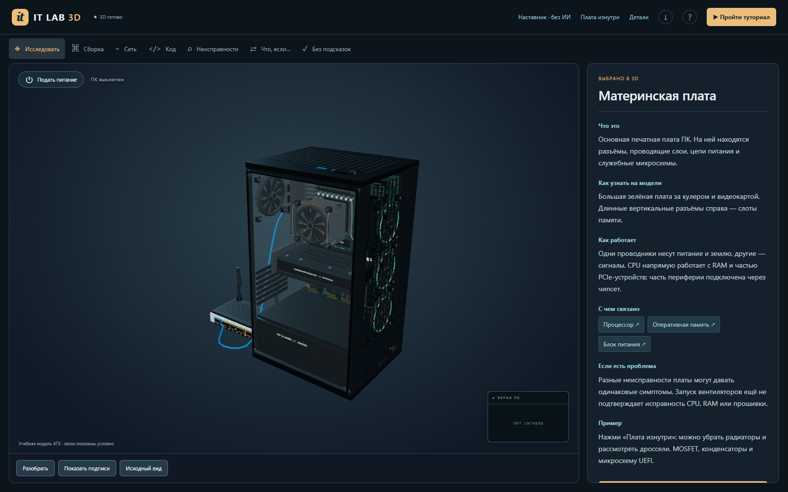
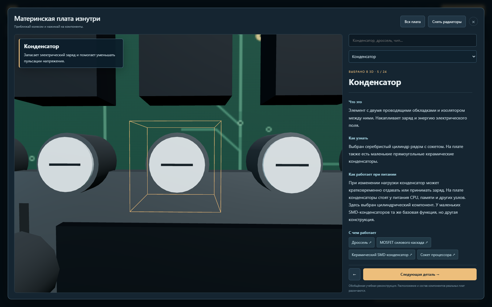

# IT Lab 3D

**Виртуальная компьютерная мастерская для начинающих студентов колледжа.**

Здесь можно разобрать системный блок в 3D, нажать на компонент и узнать, что это, как он работает и с чем связан. Затем — собрать компьютер, найти учебную неисправность и проверить результат своих действий.



## Быстрый запуск

Самый простой способ:

1. В GitHub нажмите **Code → Download ZIP**.
2. Распакуйте скачанный архив.
3. Откройте файл **`index.html`** из распакованной папки в Chrome или Edge.

Файл содержит модель и учебные материалы; интернет для практик не нужен. Наставник в этом режиме использует встроенные подсказки.

Для локального сайта с сервером нужен **Node.js**. Проект проверен на Node.js 24; внешних npm-зависимостей нет.

```sh
git clone https://github.com/kkuanyshevna/IT-LAB-3D.git
cd IT-LAB-3D
npm start
```

Откройте **http://127.0.0.1:4317**. Чтобы остановить сервер, нажмите `Ctrl+C` в терминале. Выполнять `npm install` для текущей версии не требуется.

## С чего начать

1. В разделе **«Исследовать»** нажмите на деталь. Справа появятся её название, устройство, принцип работы и пример.
2. Откройте **«Плата изнутри»**. Приближайте колёсиком, вращайте мышью и нажимайте на мелкие компоненты. Кнопка **«Снять радиаторы»** открывает элементы под ними. Полный разбор справа можно прокручивать.
3. Пройдите **«Туториал»**: десять шагов показывают, что происходит при запуске ПК.
4. Перейдите в **«Сборку»** или **«Неисправности»**, выполните действия и проверьте результат.

Ссылки внутри карточек ведут к связанным деталям. Например, можно последовательно рассмотреть контроллер VRM, MOSFET, дроссель и конденсатор.



## Учебные режимы

| Режим | Что можно сделать |
| --- | --- |
| Исследовать | Рассмотреть 12 крупных узлов; открыть разбор платы с 24 типами компонентов |
| Туториал | Пройти запуск: от дежурного питания и прошивки до загрузки ОС |
| Сборка | Перетащить RAM, SSD и видеокарту в нужные разъёмы, включить ПК и проверить экран |
| Неисправности | Найти причину отсутствия изображения, загрузчика или сетевого канала |
| Что, если… | Снять компонент при выключенном питании и увидеть результат следующего запуска |
| Без подсказок | Самостоятельно выполнить диагностику и получить разбор действий |
| Сеть | Подключить кабель, получить настройки DHCP и проверить учебный шлюз |
| Код | Выполнять простую программу пошагово и наблюдать значения в RAM и вывод |

В практике нельзя установить внутреннюю деталь под питанием, через закрытую панель или в неправильный слот. Для завершения ремонта нужны исходная проверка, исправление и повторная проверка после изменения конфигурации. Журнал можно сохранить в TXT кнопкой со стрелкой вниз.

## Что с ИИ

**Без API-ключа живая модель не работает.** Интерфейс честно показывает «без ИИ» и использует готовые подсказки по правилам. Они учитывают выбранный компонент и состояние стенда, но не отвечают на произвольные вопросы как языковая модель.

Серверное подключение к OpenAI Responses API уже подготовлено. Наставник получает вопрос, описание выбранной детали и наблюдаемые результаты действий. В самостоятельной проверке помощь заблокирована.

Чтобы подключить модель локально:

1. Скопируйте **[.env.example](.env.example)** в `.env.local` в корне проекта.
2. Укажите свой ключ в `OPENAI_API_KEY`. При необходимости задайте доступную вашему аккаунту модель через `OPENAI_MODEL`.
3. Перезапустите `npm start`, обновите страницу и откройте наставника.

Файл `.env.local` не попадает в Git. Не добавляйте ключ в HTML или браузерный JavaScript. Для загрузки `.env.local` нужен Node.js 20.12+; весь проект проверен на Node.js 24.

Проверка настройки: **http://127.0.0.1:4317/api/mentor/status**. Значение `configured: true` означает, что сервер нашёл ключ. Доступ к выбранной модели подтверждается первым успешным ответом. Без ключа API возвращает 503, а интерфейс продолжает работать со встроенными подсказками. Подключение проверено тестовыми ответами провайдера; реальный запрос потребует вашего ключа.

Для хостинга используется ES-модуль **[worker/index.js](worker/index.js)**. Секрет передаётся серверу как `OPENAI_API_KEY`; также поддерживается секретное хранилище Sites через `env.SECRET_OPENAI_API_KEY.get()`. Размещение одного HTML на статическом хостинге не запускает серверный API.

## Сборка и проверка

```sh
npm test
npm run build
npm start
```

`npm test` запускает 48 проверок логики практик, интерпретатора и API наставника. `npm run build` обновляет автономные HTML и Worker после изменения исходников. После сборки обновите открытую вкладку браузера.

## Где что находится

| Файл или папка | Назначение |
| --- | --- |
| `index.html` | Готовый автономный учебный сайт |
| `portal.html`, `portal.css`, `portal.js` | Интерфейс и переключение режимов |
| `model.js` | Геометрия ПК и взаимодействие с крупными узлами |
| `micro-data.js`, `micro-inspector.js` | Компоненты платы, приближение и выбор |
| `component-lessons.js` | Подробные объяснения деталей и технические источники |
| `engine.js`, `lab-engine.js` | Правила практик, состояние стенда и интерпретатор |
| `mentor-service.mjs` | Серверное подключение наставника |
| `serve.cjs` | Локальный HTTP-сервер |
| `viewer-template.html` | Оболочка 3D с встроенными Three.js и OrbitControls |
| `computer.html`, `viewer-data.js`, `worker/` | Файлы, которые создаёт сборка |
| `docs/` | Презентация, описание проекта и изображения |

**[Скачать презентацию](docs/IT-Lab-3D-presentation.pptx)** · **[Описание проекта](docs/PROJECT.md)**

## Ограничения

- Модель показывает обобщённую плату, а не точную копию конкретного изделия. Не каждый декоративный SMD-элемент имеет отдельную карточку.
- Электрические и тепловые процессы не рассчитываются. Маркеры показывают функциональные связи, а не движение электронов или реальные трассы платы.
- Сеть виртуальная. Ответ учебного шлюза не проверяет подключение компьютера к интернету.
- Интерпретатор поддерживает ограниченное подмножество Python: числа, переменные, арифметику, присваивание и `print`.
- Прогресс хранится в текущей вкладке до перезагрузки или смены режима. Автоматический разбор не заменяет оценку преподавателя.

## Если что-то не запускается

| Ситуация | Что сделать |
| --- | --- |
| Не появилась 3D-модель | Открыть сайт в современном браузере с WebGL и включённым графическим ускорением |
| Видна старая версия | Обновить страницу через `Ctrl+F5` |
| Порт 4317 занят | Остановить предыдущий сервер или задать `ITLAB_PORT` перед запуском |
| Наставник показывает «без ИИ» | Проверить `.env.local`, перезапустить сервер и открыть `/api/mentor/status` |
| Ключ настроен, но модель не отвечает | Проверить доступ к модели, состояние API-аккаунта и соединение; встроенные подсказки останутся доступны |

Геометрия и учебная логика подготовлены с помощью Codex. Приложение использует Three.js и OrbitControls; лицензионные уведомления сохранены во встроенном 3D-движке. Технические источники перечислены в `component-lessons.js` и доступны через окно «О проекте».
